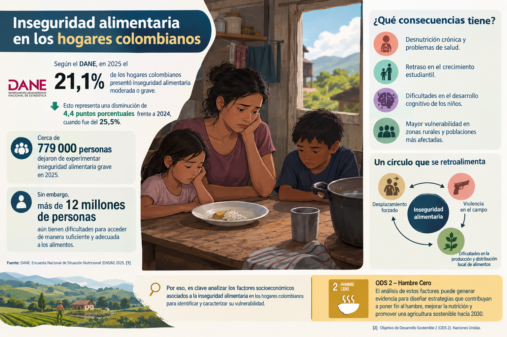
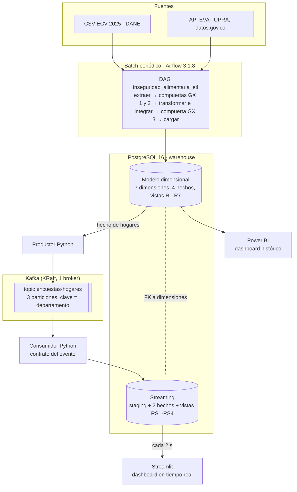
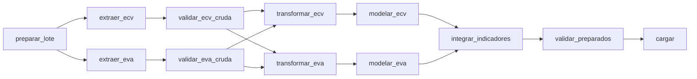
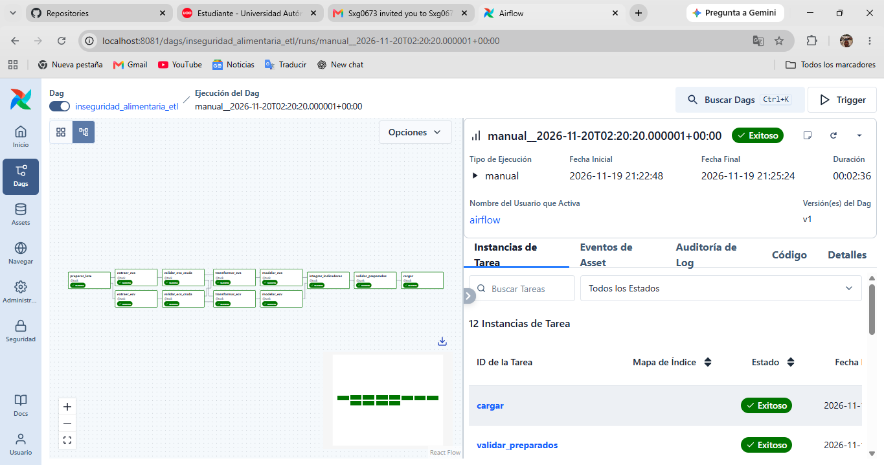
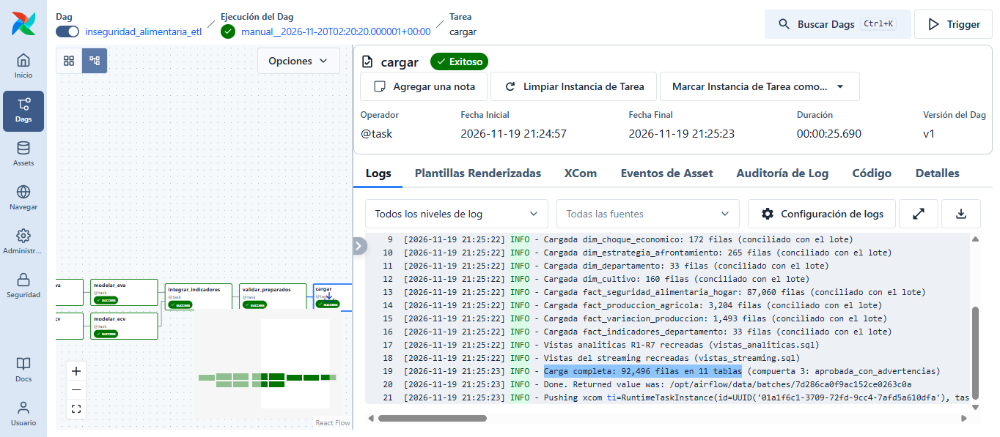
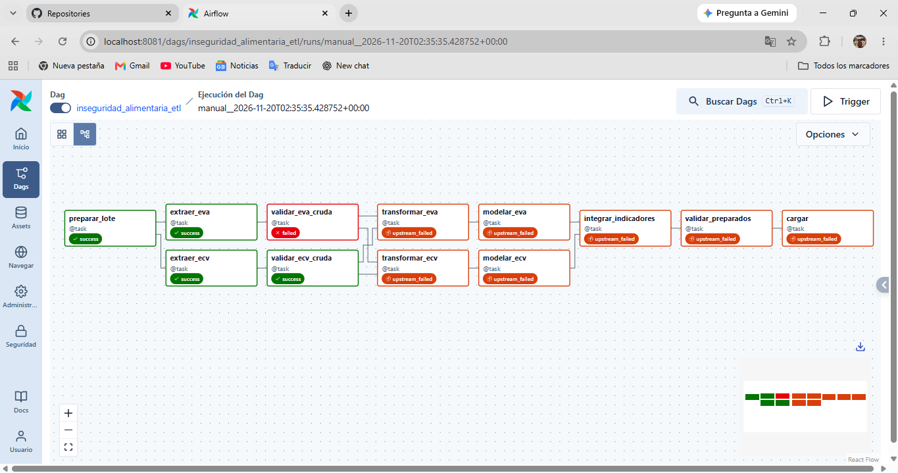
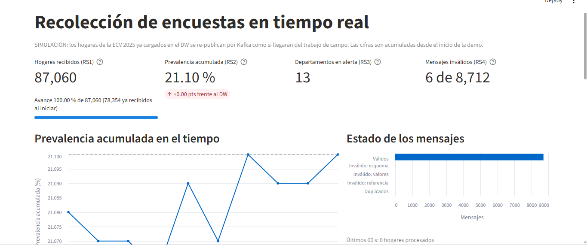
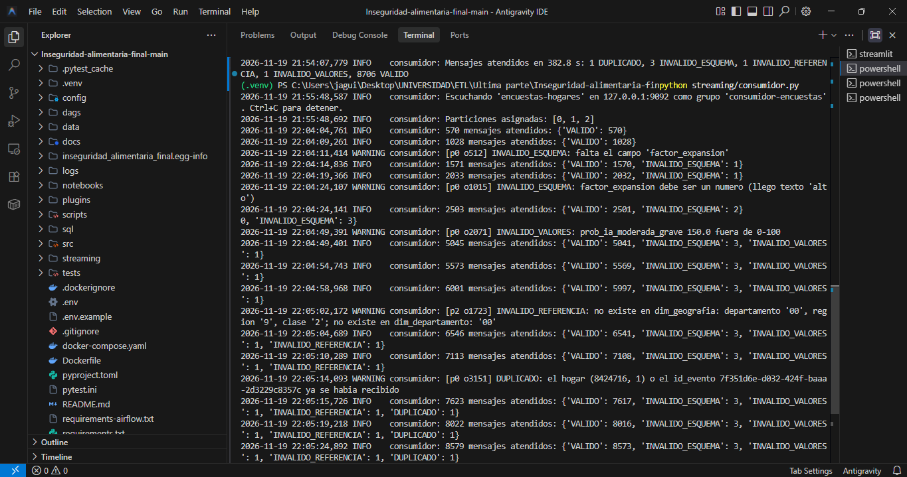
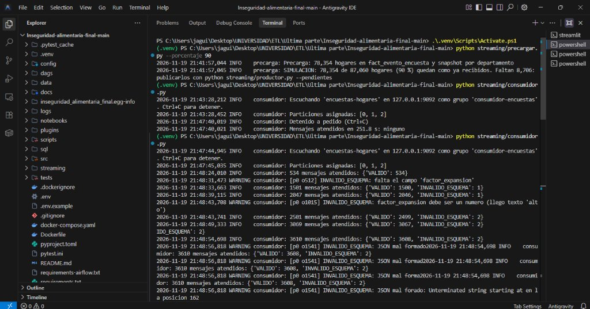

# Factores socioeconómicos asociados a la inseguridad alimentaria en los hogares colombianos

<p align="center">
  <strong>Entrega final del proyecto ETL: integración de la ECV 2025 del DANE y las Evaluaciones Agropecuarias Municipales (EVA) de la UPRA, con procesamiento batch orquestado en Airflow y un componente de streaming con Kafka.</strong>
</p>

---

## Índice

- [1. Descripción del proyecto y objetivos](#1-descripción-del-proyecto-y-objetivos)
  - [1.1 Contexto y problema](#11-contexto-y-problema)
  - [1.2 Stakeholders](#12-stakeholders)
  - [1.3 Alineación con los Objetivos de Desarrollo Sostenible (ODS)](#13-alineación-con-los-objetivos-de-desarrollo-sostenible-ods)
  - [1.4 Requerimientos analíticos batch (R1–R7) y de baja latencia (RS1–RS4)](#14-requerimientos-analíticos-batch-r1r7-y-de-baja-latencia-rs1rs4)
  - [1.5 Matriz de cumplimiento de objetivos](#15-matriz-de-cumplimiento-de-objetivos)
- [2. Fuentes de datos y EDA](#2-fuentes-de-datos-y-eda)
  - [2.1 Fuentes de datos del sistema](#21-fuentes-de-datos-del-sistema)
  - [2.2 Valor analítico de la integración](#22-valor-analítico-de-la-integración)
  - [2.3 Síntesis del perfilamiento exploratorio (EDA)](#23-síntesis-del-perfilamiento-exploratorio-eda)
  - [2.4 Matriz: Hallazgo del EDA → Decisión de limpieza/transformación → Regla de calidad](#24-matriz-hallazgo-del-eda--decisión-de-limpiezatransformación--regla-de-calidad)
- [3. Arquitectura del sistema](#3-arquitectura-del-sistema)
- [4. Pipeline ETL batch](#4-pipeline-etl-batch)
  - [4.1 Diseño del DAG y gestión de lotes](#41-diseño-del-dag-y-gestión-de-lotes)
  - [4.2 Interfaces y contratos de tareas](#42-interfaces-y-contratos-de-tareas)
  - [4.3 Políticas de fallos y reintentos selectivos](#43-políticas-de-fallos-y-reintentos-selectivos)
  - [4.4 Justificación de la programación semanal](#44-justificación-de-la-programación-semanal)
- [5. Calidad de datos](#5-calidad-de-datos)
  - [5.1 Catálogo de reglas de calidad (Great Expectations)](#51-catálogo-de-reglas-de-calidad-great-expectations)
  - [5.2 Evidencia de corrida real](#52-evidencia-de-corrida-real)
  - [5.3 Comportamiento ante fallos críticos controlados](#53-comportamiento-ante-fallos-críticos-controlados)
- [6. Data Warehouse](#6-data-warehouse)
  - [6.1 Modelo dimensional refinado](#61-modelo-dimensional-refinado)
  - [6.2 Granularidad, dimensiones y tablas de hechos](#62-granularidad-dimensiones-y-tablas-de-hechos)
  - [6.3 Estrategia de carga transaccional e idempotente](#63-estrategia-de-carga-transaccional-e-idempotente)
  - [6.4 Vistas analíticas y materializadas](#64-vistas-analíticas-y-materializadas)
- [7. Dashboard analítico batch](#7-dashboard-analítico-batch)
  - [7.1 Conexión y reglas de lectura](#71-conexión-y-reglas-de-lectura)
  - [7.2 Cobertura de requerimientos R1–R7](#72-cobertura-de-requerimientos-r1r7)
  - [7.3 Evidencia visual del informe Power BI](#73-evidencia-visual-del-informe-power-bi)
- [8. Pipeline de streaming](#8-pipeline-de-streaming)
  - [8.1 Justificación y simulación de baja latencia](#81-justificación-y-simulación-de-baja-latencia)
  - [8.2 Contrato del evento y validación en 4 capas](#82-contrato-del-evento-y-validación-en-4-capas)
  - [8.3 Consumidor en micro-lotes y garantías de entrega](#83-consumidor-en-micro-lotes-y-garantías-de-entrega)
  - [8.4 Modelo y métricas en tiempo real (RS1–RS4)](#84-modelo-y-métricas-en-tiempo-real-rs1rs4)
- [9. Dashboard en tiempo real](#9-dashboard-en-tiempo-real)
- [10. Ejecución y reproducibilidad](#10-ejecución-y-reproducibilidad)
- [11. Evidencia funcional](#11-evidencia-funcional)
- [12. Decisiones de ingeniería y limitaciones](#12-decisiones-de-ingeniería-y-limitaciones)
- [13. Integrantes y responsabilidades](#13-integrantes-y-responsabilidades)

---

## 1. Descripción del proyecto y objetivos

### 1.1 Contexto y problema

En Colombia, la **Encuesta Nacional de Calidad de Vida (ECV) 2025**, producida por el **Departamento Administrativo Nacional de Estadística (DANE)**, ofrece información socioeconómica y territorial a nivel de hogar. Esta fuente permite estudiar conjuntamente las condiciones de vida y las medidas de inseguridad alimentaria derivadas de la escala FIES (*Food Insecurity Experience Scale*), con representatividad nacional y departamental.

No obstante, la vulnerabilidad alimentaria no depende exclusivamente de las condiciones internas del hogar: el entorno productivo agrícola de los territorios condiciona la disponibilidad local de alimentos. Por ello, este proyecto integra la ECV con las **Evaluaciones Agropecuarias Municipales (EVA 2024–2025)** de la **Unidad de Planificación Rural Agropecuaria (UPRA)**.

El proyecto responde a la siguiente pregunta central de investigación:

> **¿Qué factores socioeconómicos, territoriales y de producción agrícola están asociados con una mayor prevalencia de inseguridad alimentaria en los hogares colombianos?**




### 1.2 Stakeholders

| Stakeholder | Interés en el problema | Uso potencial de los resultados |
|---|---|---|
| **DANE** | Producción, evaluación y divulgación de estadísticas oficiales sobre calidad de vida. | Contrastar cifras FIES, validar consistencia metodológica y orientar futuros operativos. |
| **Ministerio de Igualdad y DPS** | Focalización de subsidios y programas de asistencia alimentaria. | Priorizar transferencias condicionadas hacia territorios y hogares con choques no resueltos. |
| **Ministerio de Agricultura y UPRA** | Planificación agropecuaria y soberanía alimentaria territorial. | Identificar departamentos con caídas críticas en cultivos básicos de la canasta alimentaria. |
| **Gobernaciones y Alcaldías** | Comprensión de brechas territoriales intrarregionales. | Formular planes locales de desarrollo y abastecimiento nutricional. |
| **Organizaciones Humanitarias (PMA, FAO)** | Detección temprana de crisis y monitoreo de vulnerabilidad. | Activar ayudas humanitarias ante caídas productivas y alertas operativas en tiempo real. |
| **Comunidad Académica y Ciudadanía** | Investigación reproducible y control social. | Auditar metodologías de integración y explorar determinantes sociales de la nutrición. |

### 1.3 Alineación con los Objetivos de Desarrollo Sostenible (ODS)

| ODS | Relación con el proyecto | Contribución concreta |
|---|---|---|
| **ODS 2: Hambre Cero** | Núcleo temático central: medición de la inseguridad alimentaria moderada y grave. | Genera evidencia sobre la prevalencia FIES y la disponibilidad de cultivos de la canasta básica. |

### 1.4 Requerimientos analíticos batch (R1–R7) y de baja latencia (RS1–RS4)

El sistema distingue dos horizontes analíticos complementarios:

#### Requerimientos Batch (Históricos, carga periódica en Airflow)
* **R1 (Distribución territorial):** Caracterizar la prevalencia de inseguridad alimentaria moderada o grave y grave por región y departamento.
* **R2 (Servicios públicos):** Evaluar la relación entre carencia de acueducto y alcantarillado con la vulnerabilidad alimentaria del hogar.
* **R3 (Choques económicos):** Analizar el impacto de eventos adversos recientes (pérdida de empleo, atrasos en servicios, quiebra de negocios) sobre el acceso a alimentos.
* **R4 (Estrategias de afrontamiento):** Identificar las conductas de mitigación adoptadas por el hogar (endeudamiento, reducción de gasto en alimentos, venta de bienes) según el nivel de severidad FIES.
* **R5 (Gradiente de ingreso):** Medir la prevalencia de inseguridad alimentaria a lo largo de los quintiles de ingreso per cápita del hogar.
* **R6 (Diversidad agrícola integrada):** Determinar si los departamentos con mayor diversidad de cultivos alimentarios cosechados en 2025 presentan menor prevalencia FIES.
* **R7 (Variación productiva interanual):** Evaluar si los departamentos con mayor porcentaje de cultivos de la canasta en descenso productivo (2024 vs. 2025) exhiben mayor vulnerabilidad alimentaria.

#### Requerimientos de Streaming (Baja latencia, eventos en Kafka y Streamlit)
* **RS1 (Avance de recolección):** Monitorear en tiempo real el porcentaje de hogares encuestados recibidos frente a la muestra esperada (nacional y departamental).
* **RS2 (Prevalencia acumulada en vivo):** Calcular la prevalencia FIES ponderada acumulada a medida que ingresan los eventos, observando su convergencia con la referencia anual del DW.
* **RS3 (Alerta temprana departamental):** Activar alertas operativas automáticas para departamentos donde el límite inferior del intervalo de confianza (IC 95% Wilson) supera la prevalencia de referencia nacional.
* **RS4 (Salud del flujo y calidad):** Fiscalizar la latencia del pipeline (media y p95) y contabilizar mensajes descartados por violación del contrato (esquema, valores, referencias o duplicados).

> **Justificación del componente de streaming:** En un operativo censal o de encuesta de campo real, esperar el cierre y consolidación anual (6 a 12 meses) retrasa la intervención social. Monitorear los microdatos a medida que los encuestadores sincronizan sus dispositivos permite a las agencias humanitarias identificar departamentos en alerta nutricional semanas antes de la publicación oficial.

### 1.5 Matriz de cumplimiento de objetivos

| Requerimiento | Pregunta analítica / operativa | Cómo se cumplió en el sistema | Evidencia técnica |
|---|---|---|---|
| **R1** | ¿Cómo varía la inseguridad alimentaria entre regiones y departamentos? | Cálculo de prevalencia FIES ponderada con `FEX_C` a nivel departamental y regional. | Vista `vw_r1_distribucion_territorial`. |
| **R2** | ¿La falta de acueducto y alcantarillado incrementa el riesgo de hambre? | Cruce de atributos de servicios en `fact_seguridad_alimentaria_hogar`. | Vista `vw_r2_servicios_publicos`. |
| **R3** | ¿Cómo afecta la acumulación de choques económicos al hogar? | Modelado de dimensión *junk* con 11 eventos adversos y conteo de choques. | Vista `vw_r3_choques_economicos`. |
| **R4** | ¿Qué estrategias activan los hogares según su nivel de severidad? | Mapeo de 14 estrategias de supervivencia cruzadas con la escala FIES (0 a 8). | Vista `vw_r4_estrategias_severidad`. |
| **R5** | ¿Existe un gradiente claro entre quintiles de ingreso e inseguridad alimentaria? | Construcción de quintiles ponderados por factor de expansión y aislamiento de anomalías. | Vista `vw_r5_quintiles_ingreso`. |
| **R6** | ¿La diversidad agrícola local mitiga la prevalencia departamental? | Conteo de cultivos de la canasta alimentaria con producción positiva en 2025. | Vista `vw_r6_diversidad_departamental`. |
| **R7** | ¿Las caídas productivas agrícolas se asocian con mayor hambre? | Cálculo de variación porcentual interanual (2024–2025) y % de cultivos en descenso. | Vistas `vw_r7_variacion_cultivo` y `vw_r7_descenso_departamental`. |
| **RS1** | ¿Cuál es el avance del operativo de recolección en tiempo real? | Agregación en micro-lotes de encuestas recibidas vs. muestra total de la ECV. | Vista `vw_stream_departamento_actual` / Métrica RS1. |
| **RS2** | ¿A qué valor converge la prevalencia acumulada durante el flujo? | Ratio acumulativo de $\sum(\text{factor} \times \text{prob}) / \sum\text{factor}$ en PostgreSQL. | Vista `vw_stream_nacional` / Métrica RS2. |
| **RS3** | ¿Qué territorios requieren focalización urgente durante la recolección? | Cálculo dinámico del límite inferior del IC 95% Wilson con umbral de 30 hogares. | Indicador visual de alerta en Streamlit / Métrica RS3. |
| **RS4** | ¿El canal de eventos opera con baja latencia y sin corromper datos? | Trazabilidad en `stg_evento_encuesta` registrando latencia y causa de rechazo. | Vista `vw_stream_salud` / Métrica RS4. |

---

## 2. Fuentes de datos y EDA

### 2.1 Fuentes de datos del sistema

| Característica | ECV 2025 (Primaria Batch) | EVA 2024–2025 (API Batch) | Eventos Encuesta (Streaming) |
|---|---|---|---|
| **Entidad responsable** | DANE (DIMPE). | UPRA (Ministerio de Agricultura). | Simulación de trabajo de campo (basada en ECV). |
| **Mecanismo de acceso** | Descarga manual de 3 archivos CSV. | HTTP GET a API Socrata SODA (`uejq-wxrr.json`). | Broker Apache Kafka (topic `encuestas-hogares`). |
| **Formato y codificación** | CSV delimitado por `;`, `utf-8-sig`. | JSON estructurado (texto plano). | Mensajes JSON serializados en UTF-8 con clave. |
| **Granularidad de entrada** | Vivienda y Hogar. | Municipio × Código de Cultivo × Período. | Encuesta individual de un Hogar (`directorio`, `orden`). |
| **Llaves naturales** | `DIRECTORIO`, `ORDEN`; depto `P1_DEPARTAMENTO`. | `c_digo_dane_municipio`, `c_digo_del_cultivo`, `periodo`. | Clave de mensaje: `codigo_departamento`; payload: `id_evento`. |
| **Volumen extraído** | 87.060 hogares integrados (286 columnas). | 51.170 registros (25.553 en 2024; 25.617 en 2025). | 87.060 eventos emitidos (demo de ~8.700 pendientes). |
| **Limitaciones conocidas** | No se distribuye en Git por peso (~150 MB). | Datos provisionales susceptibles de revisión anual. | Dependiente de la carga previa del Data Warehouse. |

### 2.2 Valor analítico de la integración

La integración entre la ECV y la EVA resuelve una limitación estructural clásica: las encuestas de hogares capturan la **demanda y el acceso económico a los alimentos**, pero ignoran la **disponibilidad física y la resiliencia productiva local**. Al acoplar ambas fuentes mediante el código departamental DIVIPOLA:
1. Se evalúa si departamentos con mayor diversidad agroalimentaria (variedad de frutas, hortalizas, tubérculos y cereales) ofrecen mayor protección nutricional a sus hogares (R6).
2. Se detecta el impacto de choques climáticos o productivos de corto plazo (caídas en toneladas entre 2024 y 2025) sobre los indicadores de hambre FIES (R7).
3. Se aíslan departamentos sin vocación agrícola (caso Bogotá D.C., que consume pero no cultiva) preservando el valor nulo analítico en lugar de imputar cero.

### 2.3 Síntesis del perfilamiento exploratorio (EDA)

El perfilamiento sobre los datos completos (notebooks `00_profiling_ecv_hogares.ipynb`, `01_profiling_eva.ipynb` y `02_profiling_ecv_departamental.ipynb`) arrojó hallazgos determinantes:

* **ECV a nivel hogar (87.060 registros):**
  * **Integridad de llaves:** La unión `condiciones_vida` $\to$ `servicios_hogar` por `(DIRECTORIO, ORDEN)` y con `vivienda` por `DIRECTORIO` preserva exactamente 87.060 filas, sin huérfanos ni multiplicación cartesiana.
  * **Columnas vacías:** Se detectaron 21 columnas 100% vacías (`P9025`, `P3180`, `P3202`, `P3516`, etc.) correspondientes a encabezados de baterías múltiples en el diseño de captura del DANE.
  * **Estructura FIES:** 718 hogares tienen nulas las probabilidades `PROB_IAMG` y `PROB_IAG`, coincidiendo de forma idéntica con respuestas "No sabe / No informa" (código 3). La prevalencia ponderada calculada sobre los 86.342 hogares restantes es **21,10%**, reconciliando con la cifra oficial reportada por el DANE.
  * **Inconsistencias de ingreso:** 3 registros presentan `PERCAPITA = 0` con `I_HOGAR > 0` (hasta \$2.608.333). Se aíslan en una categoría para no distorsionar los quintiles de R5.
* **EVA a nivel municipal (51.170 registros):**
  * **Esquema textual:** La API entrega todos los campos como cadenas de texto, requiriendo *casting* numérico estricto.
  * **Área cosechada > sembrada:** Se identificaron 6.950 registros donde el área cosechada supera la sembrada. Según la metodología UPRA vigente desde 2022, en cultivos transitorios esto es válido pues refleja cosechas efectivas de siembras de períodos precedentes.
  * **Canasta alimentaria:** De 160 cultivos en EVA, se definieron 139 incluidos y 21 excluidos (pastos, flores, tabaco, forestales y medicinales), cruzados con la pregunta de gasto en alimentos P3204 de la ECV.
* **Eventos de Streaming:**
  * Al simular la llegada en campo, los eventos deben cumplir un contrato estricto de tipos, rangos lógicos ($0 \le \text{prob} \le 100$, $\text{prob\_grave} \le \text{prob\_moderada}$), consistencia referencial y control de duplicidad.

### 2.4 Matriz: Hallazgo del EDA → Decisión de limpieza/transformación → Regla de calidad

| Hallazgo / Problema en EDA | Decisión de limpieza / transformación | Regla de calidad asociada |
|---|---|---|
| 21 columnas de la ECV están 100% vacías (encabezados de preguntas). | Se eliminan en `src/ecv/clean.py` para liberar memoria y evitar sesgos. | Estructura interna ECV. |
| 6.365 hogares presentan código de departamento de 1 solo dígito en la ECV. | Se aplica normalización `zfill(2)` antes del cruce DIVIPOLA. | **C2** (DIVIPOLA en ECV). |
| Códigos de departamento y municipio en EVA con inconsistencia de longitud. | Se valida formato estándar de 2 dígitos (depto) y 5 dígitos (municipio). | **C8** (DIVIPOLA en EVA). |
| 3 hogares tienen `PERCAPITA = 0` pero ingresos del hogar mayores a \$1.000.000. | Se clasifican en la categoría `"Dato inconsistente"` en `dim_nivel_ingreso`. | Tratamiento R5 en `transform.py`. |
| 718 hogares no respondieron la batería de preguntas FIES (código 3). | Se mapean a severidad `"Sin dato"` y se excluyen del denominador de prevalencia. | **C12** (Severidad y FIES). |
| 74.125 hogares sin choques económicos tienen 0 estrategias de supervivencia. | Se garantiza consistencia lógica biunívoca: sin choques $\iff$ sin estrategias. | **C13** (Consistencia choques/estrategias). |
| La API EVA devuelve números con formato de cadena de texto. | Parseo estricto con regex `^\d+(\.\d+)?$` y conversión a punto decimal. | **C6** (Medidas numéricas EVA). |
| Paginación en bloques de 5.000 registros puede omitir registros si hay caídas. | Conciliación contra el `$select=count(*)` oficial reportado por la API SODA. | **C3** (Completitud extracción EVA). |
| Registros de cultivos no alimentarios (café no procesado, flores, tabaco). | Filtrado por catálogo fijo de canasta alimentaria (`config/canasta_cultivos.csv`). | **C9** (Canasta alimentaria). |
| Riesgo de división por cero en cultivos con producción base 2024 en cero. | Clasificación explícita en estados: `comparable`, `base_cero`, `solo_2024`, `solo_2025`. | **C16** (Comparabilidad de variación). |
| Mensajes en Kafka con campos faltantes, tipos erróneos o fuera de rango. | Rechazo en micro-lote, asignación de estado y persistencia en staging. | Contrato Streaming (Esquema/Valores). |
| Eventos con departamentos inexistentes en el DW o reenvío de hogares. | Verificación contra dimensiones y restricción de unicidad `(directorio, orden)`. | Contrato Streaming (Referencia/Duplicado). |

---

## 3. Arquitectura del sistema



| Componente | Dónde corre | Función |
|---|---|---|
| **Airflow 3.1.8** | Docker Compose | Orquestación del pipeline batch, ejecución de compuertas y aislamiento por lotes. |
| **PostgreSQL 16** | Docker Compose | Almacén de metadatos de Airflow (puerto 5432 interno) y Data Warehouse analítico (puerto publicado 5434). |
| **Apache Kafka 3.9.1** | Docker Compose (perfil `streaming`) | Transporte de eventos en modo KRaft, topic `encuestas-hogares` con 3 particiones. |
| **Productor y Consumidor** | Entorno virtual Python 3.12/3.13 | Emisión de eventos simulados, validación de contrato en micro-lotes e inserción en el DW. |
| **Streamlit 1.67** | Entorno virtual Python 3.12/3.13 | Dashboard de baja latencia con refresco cada 2 segundos conectado a las vistas de streaming. |
| **Power BI Desktop** | Equipo local del analista | Conexión directa al Data Warehouse para análisis multidimensional histórico (R1–R7). |

---

## 4. Pipeline ETL batch

### 4.1 Diseño del DAG y gestión de lotes

El DAG principal `inseguridad_alimentaria_etl` ([dags/etl_dag.py](dags/etl_dag.py)) implementa un diseño de convergencia por compuertas:



* **Principio de aislamiento por lotes:** Airflow orquesta pero **no transmite datos por XCom**. Cada corrida genera una carpeta inmutable en `data/batches/<sha256(run_id)>/`.
* **Inmutabilidad y trazabilidad:** Toda extracción o archivo intermedio se almacena en formato Parquet y se registra con su respectivo hash `SHA-256` en un manifiesto JSON. Si un archivo es adulterado, el pipeline se detiene.

### 4.2 Interfaces y contratos de tareas

| Tarea Airflow | Entrada | Salida en el lote | Criterio de parada |
|---|---|---|---|
| `preparar_lote` | `run_id` de la corrida. | Carpeta de lote y `lote.json`. | Error de sistema de archivos. |
| `extraer_ecv` | CSV locales en `data/raw/ecv/`. | Copias congeladas en `ecv/raw/` y manifiesto. | Ausencia de cualquiera de los 3 CSV. |
| `validar_ecv_cruda` | Manifiesto y CSV de ECV. | Reporte `calidad/compuerta_1.json`. | Fallo en reglas C1 o C2. |
| `extraer_eva` | API SODA UPRA; param `falla_controlada`. | `eva/raw/eva_2024_2025.json` y manifiesto. | API caída (tras reintentos) o error 4xx. |
| `validar_eva_cruda` | JSON crudo de la API. | Reporte `calidad/compuerta_2.json`. | Fallo en reglas C3 a C9. |
| `transformar_ecv` | Lote validado por compuerta 1 y 2. | `ecv/procesado/hogares_transformados.parquet`. | Alteración de hash SHA-256. |
| `modelar_ecv` | Tabla transformada. | 5 dimensiones Parquet y hecho de hogares. | Duplicidad en llaves sustitutas. |
| `transformar_eva` | Lote EVA validado por compuertas 1 y 2. | `eva/procesado/produccion_agregada.parquet`. | Cultivo sin clasificación en canasta. |
| `modelar_eva` | Agregados de producción y DIVIPOLA. | Dimensiones `dim_cultivo`, `dim_departamento` y 2 hechos. | Código territorial inválido. |
| `integrar_indicadores` | Modelos ECV y EVA. | `integrado/procesado/fact_indicadores_departamento.parquet`. | Departamento ECV huérfano. |
| `validar_preparados` | Todas las tablas del modelo Parquet. | Reporte `calidad/compuerta_3.json`. | Fallo en reglas C10 a C16. |
| `cargar` | Tablas aprobadas por compuerta 3. | 11 tablas en PostgreSQL y `carga/carga.json`. | Fallo de conexión o descuadre de filas. |

### 4.3 Políticas de fallos y reintentos selectivos

1. **Errores Deterministas (`ErrorDeterminista`):** Violaciones de reglas críticas de Great Expectations, esquemas alterados o discrepancias en conteos. Se transforman inmediatamente en `AirflowFailException` y **nunca se reintentan** (reintentar reproduciría el mismo fallo).
2. **Errores Transitorios (`ErrorTransitorio`):** Caídas de red hacia la API SODA o reinicios temporales del contenedor del Data Warehouse. Se configuran reintentos selectivos:
   * `extraer_eva`: 2 reintentos con intervalo de 5 minutos (sumados a los 3 reintentos inmediatos con *backoff* exponencial del extractor).
   * `cargar`: 2 reintentos con intervalo de 1 minuto para tolerar reinicios del servicio `warehouse`.

### 4.4 Justificación de la programación semanal

El DAG está configurado con `schedule='@weekly'` y `catchup=False`. La UPRA advierte formalmente que las cifras de las Evaluaciones Agropecuarias Municipales de los dos últimos años (2024–2025) son preliminares y sujetas a revisión periódica. Una frecuencia semanal permite incorporar ajustes oficiales en la producción agrícola sin saturar la infraestructura. Fijar `catchup=False` evita corridas retroactivas innecesarias si el entorno estuvo inactivo.

---

## 5. Calidad de datos

### 5.1 Catálogo de reglas de calidad (Great Expectations)

El sistema implementa 19 reglas formales mediante Great Expectations 1.23.1 ([docs/reglas_calidad.md](docs/reglas_calidad.md)), distribuidas en tres compuertas de paso obligado:

| Compuerta | ID | Tipo | Regla evaluada | Umbral | Severidad | Requerimiento protegido |
|---|---|---|---|---|---|---|
| **1: ECV Cruda** | **C1** | Unicidad | Llave compuesta `(DIRECTORIO, ORDEN)` única y no nula. | 0 duplicados, 0 nulos | Crítica | R1–R7 |
| **1: ECV Cruda** | **C2** | Integridad | `P1_DEPARTAMENTO` con `zfill(2)` pertenece a DIVIPOLA. | 100% de cruce | Crítica | R1, R6, R7 |
| **2: EVA Cruda** | **C3** | Conciliación | Registros extraídos igual a `$select=count(*)` por año. | Diferencia = 0 | Crítica | R6, R7 |
| **2: EVA Cruda** | **C4** | Esquema | Presencia obligatoria de los 18 campos requeridos. | 18 de 18 campos | Crítica | R6, R7 |
| **2: EVA Cruda** | **C5** | Dominio | Año $\in \{2024, 2025\}$ y coherencia con período. | 100% registros | Crítica | R7 |
| **2: EVA Cruda** | **C6** | Formato | Áreas, producción y rendimiento numéricos no negativos. | 100% válidos | Crítica | R6, R7 |
| **2: EVA Cruda** | **C7** | Unicidad | Llave `(municipio, codigo_cultivo, periodo)` única. | 0 duplicados | Crítica | R6, R7 |
| **2: EVA Cruda** | **C8** | Geografía | Códigos municipales de 5 dígitos alineados con su depto. | 100% válidos | Crítica | R6, R7 |
| **2: EVA Cruda** | **C9** | Catálogo | Todo cultivo está categorizado en la canasta alimentaria. | 100% presentes | Crítica | R6, R7 |
| **2: EVA Cruda** | **A1** | Cobertura | Cobertura geográfica mínima por año en EVA. | $\ge 32$ departamentos | Advertencia | R6, R7 |
| **2: EVA Cruda** | **A2** | Atípicos | Rendimiento agrícola extremo ($> 20\times$ mediana local). | 0 registros | Advertencia | R7 |
| **3: Preparados** | **C10** | Conservación | Filas del hecho igual a hogares transformados (87.060). | Diferencia = 0 | Crítica | R1–R5 |
| **3: Preparados** | **C11** | Conciliación | Prevalencia moderada/grave nacional y departamental. | 21,10% $\pm$ 0,1% | Crítica | R1, R6, R7 |
| **3: Preparados** | **C12** | Consistencia | Severidad `"Sin dato"` $\iff$ probabilidad FIES nula. | 100% coincidencia | Crítica | R4 |
| **3: Preparados** | **C13** | Negocio | Coherencia en conteos de choques y estrategias. | 100% coincidencia | Crítica | R3, R4 |
| **3: Preparados** | **C14** | Conservación | Producción total conservada tras agregación departamental. | Diferencia $< 1$ t | Crítica | R6, R7 |
| **3: Preparados** | **C15** | Integridad | Exactamente 33 departamentos; Bogotá con diversidad nula. | 33 filas, 0 ceros falsos | Crítica | R6 |
| **3: Preparados** | **C16** | Rango | Variación porcentual finita y estados de comparabilidad. | 0 infinitos no marcados | Crítica | R7 |
| **3: Preparados** | **A3** | Robustez | Identificación de departamentos con baja muestra agrícola. | $< 15$ cultivos | Advertencia | R6, R7 |

### 5.2 Evidencia de corrida real

En la ejecución exitosa certificada ([docs/evidencia/corrida/resumen.md](docs/evidencia/corrida/resumen.md)):
* **Compuertas 1 y 2:** Aprobadas al 100% sin observaciones.
* **Compuerta 3:** Resultó `aprobada_con_advertencias` debido a la regla **A3** (departamento de Guaviare registra solo 7 cultivos comparables, marcándose con `baja_cobertura = true`).
* **Conciliación de carga:** 92.496 filas insertadas en el Data Warehouse, incluyendo exactamente 87.060 hogares en `fact_seguridad_alimentaria_hogar`.

### 5.3 Comportamiento ante fallos críticos controlados

Para validar la robustez ante datos corruptos (Test B, [docs/evidencia/falla_controlada/resumen.md](docs/evidencia/falla_controlada/resumen.md)):
1. Se disparó el DAG con el parámetro `falla_controlada = true`, inyectando un registro duplicado en la extracción de la API.
2. La tarea `validar_eva_cruda` falló inmediatamente al evaluar la regla **C7** (`ExpectCompoundColumnsToBeUnique`).
3. El estado de la compuerta 2 pasó a `rechazada`.
4. Airflow detuvo el DAG, las tareas posteriores quedaron en `upstream_failed` y **la tarea `cargar` no se ejecutó**, impidiendo que datos corruptos alcanzaran el Data Warehouse.

---

## 6. Data Warehouse

### 6.1 Modelo dimensional refinado

El Data Warehouse en PostgreSQL implementa un esquema constelación estructurado en tres componentes: Hogares (Batch), Producción Agrícola (Batch) y Eventos en Tiempo Real (Streaming).

```mermaid
erDiagram
    dim_geografia ||--o{ fact_seguridad_alimentaria_hogar : id_geografia
    dim_nivel_ingreso ||--o{ fact_seguridad_alimentaria_hogar : id_nivel_ingreso
    dim_nivel_severidad_ia ||--o{ fact_seguridad_alimentaria_hogar : id_nivel_severidad_ia
    dim_choque_economico ||--o{ fact_seguridad_alimentaria_hogar : id_choque_economico
    dim_estrategia_afrontamiento ||--o{ fact_seguridad_alimentaria_hogar : id_estrategia_afrontamiento

    dim_departamento ||--o{ fact_produccion_agricola : id_departamento
    dim_cultivo ||--o{ fact_produccion_agricola : id_cultivo
    dim_departamento ||--o{ fact_variacion_produccion : id_departamento
    dim_cultivo ||--o{ fact_variacion_produccion : id_cultivo
    dim_departamento ||--o| fact_indicadores_departamento : id_departamento

    stg_evento_encuesta ||--o| fact_evento_encuesta : id_evento_crudo
    dim_geografia ||--o{ fact_evento_encuesta : id_geografia
    dim_nivel_severidad_ia ||--o{ fact_evento_encuesta : id_nivel_severidad_ia
    dim_departamento ||--o| fact_metrica_departamento_stream : id_departamento
```



### 6.2 Granularidad, dimensiones y tablas de hechos

| Entidad | Tipo | Granularidad | Filas cargadas | Clave sustituta / Natural |
|---|---|---|---:|---|
| `dim_geografia` | Dimensión | Departamento × Clase de área (cabecera / rural). | 65 | `id_geografia` |
| `dim_nivel_ingreso` | Dimensión | Quintil de ingreso per cápita o inconsistente. | 6 | `id_nivel_ingreso` |
| `dim_nivel_severidad_ia` | Dimensión | Nivel de severidad FIES (puntaje crudo 0 a 8). | 5 | `id_nivel_severidad_ia` |
| `dim_choque_economico` | Junk Dimension | Combinación observada de choques adversos. | 172 | `id_choque_economico` |
| `dim_estrategia_afrontamiento` | Junk Dimension | Combinación observada de estrategias. | 265 | `id_estrategia_afrontamiento` |
| `dim_departamento` | Dimensión | Departamento político (atributo conformado). | 33 | `id_departamento` |
| `dim_cultivo` | Dimensión | Cultivo de la canasta alimentaria (P3204). | 160 | `id_cultivo` |
| `fact_seguridad_alimentaria_hogar` | Hecho | Un hogar encuestado en la ECV 2025. | 87.060 | `id_hogar` / `(directorio, orden)` |
| `fact_produccion_agricola` | Hecho | Departamento × Cultivo × Año agrícola. | 3.204 | `id_produccion` |
| `fact_variacion_produccion` | Hecho | Departamento × Cultivo (variación 2024–2025). | 1.493 | `(id_departamento, id_cultivo)` |
| `fact_indicadores_departamento` | Hecho | Indicadores consolidados por departamento. | 33 | `id_departamento` |
| `stg_evento_encuesta` | Staging Streaming | Mensaje crudo recibido de Kafka. | Dinámico | `id_evento_crudo` / `(topic, part, offset)` |
| `fact_evento_encuesta` | Hecho Streaming | Llegada válida de encuesta de un hogar. | Dinámico | `id_evento_encuesta` / `(directorio, orden)` |
| `fact_metrica_departamento_stream` | Snapshot Streaming | Acumulado del operativo en un departamento. | 33 | `id_departamento` |

### 6.3 Estrategia de carga transaccional e idempotente

La etapa de carga ([src/carga.py](src/carga.py)) sigue una estricta estrategia transaccional:
1. **Reinicio coordinado:** En una sola transacción se ejecuta `TRUNCATE ... CASCADE` sobre las 11 tablas del modelo y las 3 tablas del streaming. Esto garantiza que una recarga batch limpie los datos transaccionales de streaming, ya que sus claves foráneas dependen de las claves sustitutas reconstruidas.
2. **Carga en bloque:** Inserción de dimensiones antes que hechos mediante `execute_values` de `psycopg2` en lotes de 5.000 filas.
3. **Conciliación post-inserción:** Se compara `COUNT(*)` en PostgreSQL contra la cantidad de registros en cada archivo Parquet del lote. Si existe una sola diferencia, se ejecuta `ROLLBACK` total.
4. **Recreación de vistas:** Se ejecutan [sql/vistas_analiticas.sql](sql/vistas_analiticas.sql) y [sql/vistas_streaming.sql](sql/vistas_streaming.sql), refrescando las vistas materializadas de referencia.

### 6.4 Vistas analíticas y materializadas

* **Vistas Analíticas R1–R7:** Entregan los porcentajes ya ponderados por `factor_expansion` y evitan errores comunes de promediar porcentajes:
  * `vw_r1_distribucion_territorial`, `vw_r2_servicios_publicos`, `vw_r3_choques_economicos`, `vw_r4_estrategias_severidad`, `vw_r5_quintiles_ingreso`, `vw_r6_diversidad_departamental`, `vw_r7_variacion_cultivo`, `vw_r7_descenso_departamental`.
* **Vistas Materializadas de Streaming:** `vw_stream_referencia_nacional` y `vw_stream_hogares_esperados_depto`, recalculadas tras cada corrida batch para que las consultas concurrentes de Streamlit no compitan con la inserción del consumidor.

---

## 7. Dashboard analítico batch

### 7.1 Conexión y reglas de lectura

El informe en Power BI Desktop se conecta al Data Warehouse en PostgreSQL (`localhost:5434`, base `warehouse`) mediante el modo **Importar**.

> **Reglas analíticas clave ([docs/guia_dashboard.md](docs/guia_dashboard.md)):**
> 1. Consumir directamente las vistas `vw_r*` que ya traen la ponderación poblacional correcta.
> 2. La prevalencia oficial de referencia nacional es **21,10%** moderada o grave y **3,42%** grave.
> 3. Bogotá D.C. figura con `sin_dato_agricola = true` en R6 y R7; debe excluirse de los gráficos de dispersión agrícola sin alterar el ranking territorial de R1.
> 4. Los departamentos con `baja_cobertura = true` (Guaviare) deben destacarse visualmente.

### 7.2 Cobertura de requerimientos R1–R7

| Req. | Visualización recomendada | Vista del DW | Indicadores / KPIs mostrados |
|---|---|---|---|
| **R1** | Mapa de coropletas y barras ordenadas por prevalencia. | `vw_r6_diversidad_departamental` | Prevalencia moderada/grave y grave por departamento; hogares encuestados. |
| **R2** | Gráfico de barras comparativo (4 combinaciones de servicios). | `vw_r2_servicios_publicos` | Prevalencia según cobertura de acueducto y alcantarillado. |
| **R3** | Gráfico de líneas / barras según número de choques (0 a 11). | `vw_r3_choques_economicos` | Crecimiento de la vulnerabilidad alimentaria por acumulación de eventos adversos. |
| **R4** | Barras apiladas al 100% por nivel de severidad FIES. | `vw_r4_estrategias_severidad` | Distribución porcentual de las 14 estrategias de afrontamiento. |
| **R5** | Gráfico de barras por quintil de ingreso per cápita. | `vw_r5_quintiles_ingreso` | Gradiente económico (Q1 más vulnerable vs. Q5 más resiliente) y categoría inconsistente. |
| **R6** | **Dispersión:** Diversidad de cultivos (X) vs. Prevalencia (Y). | `vw_r6_diversidad_departamental` | Correlación entre variedad de cultivos cosechados y reducción de inseguridad alimentaria. |
| **R7** | **Dispersión y Tabla:** % cultivos en caída (X) vs. Prevalencia (Y). | `vw_r7_descenso_departamental`, `vw_r7_variacion_cultivo` | Impacto de caídas en la producción agrícola sobre la prevalencia; buscador de cultivos. |

### 7.3 Evidencia visual del informe Power BI

* **R1–R5 — Panorama de la inseguridad alimentaria:** Distribución territorial y análisis según el acceso a servicios públicos, los choques económicos, las estrategias de afrontamiento y los quintiles de ingreso.


* **R6 — Diversidad agrícola e inseguridad alimentaria:** Relación entre la diversidad de cultivos y la prevalencia de inseguridad alimentaria por departamento, integrando información agrícola obtenida de la API.


* **R7 — Variación productiva e inseguridad alimentaria:** Comparación de la producción agrícola entre 2024 y 2025 y análisis de los cultivos en descenso frente a la prevalencia departamental.


### Seguimiento del operativo simulado: RS1–RS4

* **RS1 — Avance de recolección:** Seguimiento del porcentaje de hogares recibidos frente a la muestra esperada, a nivel nacional y departamental.


* **RS2 — Prevalencia acumulada en vivo:** Evolución de la prevalencia FIES ponderada conforme ingresan los eventos y comparación con la referencia anual del Data Warehouse.


* **RS3 — Alerta temprana departamental:** Identificación de departamentos cuyo límite inferior del intervalo Wilson del 95 % supera la prevalencia nacional de referencia.


* **RS4 — Salud del flujo y calidad de los eventos:** Monitoreo de la latencia media y p95, los mensajes válidos, los pendientes y los descartes por esquema, valores, referencias o duplicación.


---

## 8. Pipeline de streaming

### 8.1 Justificación y simulación de baja latencia

En operativos estadísticos de gran escala, la recolección de microdatos en campo toma meses. El pipeline de streaming implementa una **simulación declarada**: toma los hogares de `fact_seguridad_alimentaria_hogar` y los re-publica individualmente hacia Kafka emulando la sincronización en vivo de los dispositivos de campo. Esto permite monitorear alertas nutricionales territoriales antes del cierre censal.

* **Topic:** `encuestas-hogares`, 3 particiones, factor de replicación 1 (Kafka KRaft).
* **Particionamiento:** Clave del mensaje = código de departamento (garantiza orden secuencial por territorio).
* **Productor idempotente:** Configurado con `enable.idempotence = true` para evitar mensajes duplicados en reintentos internos.

### 8.2 Contrato del evento y validación en 4 capas

El contrato ([src/streaming/contrato.py](src/streaming/contrato.py)) valida cada mensaje en cuatro barreras sucesivas:

```
Mensaje de Kafka ──► [Capa 1: Esquema] ──► [Capa 2: Valores] ──► [Capa 3: Referencias] ──► [Capa 4: Duplicados] ──► Fact Streaming
                           │                      │                      │                        │
                           ▼                      ▼                      ▼                        ▼
                    INVALIDO_ESQUEMA       INVALIDO_VALORES       INVALIDO_REFERENCIA         DUPLICADO
                           └──────────────────────┴──────────────────────┴────────────────────────┘
                                                                  │
                                                                  ▼
                                                      stg_evento_encuesta (con motivo)
```

1. **Esquema:** JSON válido, campos requeridos presentes y tipos de datos correctos.
2. **Valores:** Rango de probabilidades (0–100), factor $>0$ y consistencia de severidad (regla C12).
3. **Referencias:** Existencia de claves foráneas en las dimensiones del Data Warehouse.
4. **Duplicados:** Identificación de reentradas por `(directorio, orden)` o `id_evento`.

### 8.3 Consumidor en micro-lotes y garantías de entrega

El consumidor ([streaming/consumidor.py](streaming/consumidor.py)) procesa micro-lotes de hasta 200 mensajes asegurando:
* **Garantía *At-least-once* en transporte y *Exactly-once* en base de datos:** El mensaje crudo se inserta siempre en `stg_evento_encuesta` (`UNIQUE (topic, particion, desplazamiento)`).
* **Commit de offsets desacoplado:** Kafka confirma el *offset* únicamente **después** de hacer commit en la transacción SQL de PostgreSQL. Si la base falla, se hace rollback y Kafka reentrega el lote.
* **Resiliencia ante eventos corruptos:** Un evento inválido no interrumpe el consumidor; se almacena con su causa y el lote continúa.

### 8.4 Modelo y métricas en tiempo real (RS1–RS4)

* **RS1 (Avance):** Hogares recibidos / hogares de la muestra total, por departamento y nacional.
* **RS2 (Prevalencia acumulada):** $\sum(\text{factor} \times \text{prob}) / \sum\text{factor}$ en vivo. Al completar la muestra, converge con exactitud al **21,10%** del DW.
* **RS3 (Alerta temprana):** Alerta activada cuando el límite inferior del IC 95% Wilson ($\ge 30$ hogares) supera la media histórica nacional.
* **RS4 (Salud del flujo):** Monitoreo de latencia en milisegundos y balance de eventos según su estado de validación.

---

## 9. Dashboard en tiempo real

El dashboard integra los análisis de inseguridad alimentaria y producción agrícola con el seguimiento del flujo de encuestas. Se conecta al Data Warehouse en PostgreSQL mediante `localhost:5434`, base de datos `warehouse`.

Las páginas analíticas R1–R7 utilizan el modo **Importar**. Las páginas de streaming RS1–RS4 utilizan **DirectQuery**, con actualización automática configurada cada dos segundos en Power BI Desktop.

| Requerimiento | Información presentada |
|---|---|
| **RS1. Avance de recolección** | Hogares recibidos frente a la muestra esperada, con seguimiento nacional y departamental. |
| **RS2. Prevalencia acumulada** | Evolución de la prevalencia FIES ponderada y comparación con la referencia anual del DW. |
| **RS3. Alerta departamental** | Identificación de departamentos cuyo límite inferior Wilson del 95 % supera la prevalencia nacional de referencia, con un mínimo de 30 hogares con FIES. |
| **RS4. Salud y calidad** | Latencia media y p95, mensajes válidos, pendientes y descartados por esquema, valores, referencias o duplicación. |

La prevalencia se calcula como el cociente entre la suma de las probabilidades FIES multiplicadas por el factor de expansión y la suma de los factores de los hogares con información FIES. No se promedian los porcentajes departamentales.

## Hallazgos del dashboard

### Avance y prevalencia acumulada

La simulación completó **87.060 hogares**, equivalentes al **100 % de la muestra esperada**. Se precargaron 78.354 hogares y los 8.706 restantes ingresaron mediante Kafka.

La prevalencia ponderada final de inseguridad alimentaria **moderada o grave fue de 21,10 %**, mientras que la **grave fue de 3,42 %**. Durante el procesamiento, la prevalencia acumulada osciló entre 21,06 % y 21,11 %, hasta coincidir con la referencia del DW.

De los hogares recibidos, **86.342 tenían información FIES** y **718 no contaban con ella**. Estos últimos se incluyen en el avance de recolección, pero se excluyen del cálculo de prevalencia.

### Alertas departamentales

Se identificaron **13 territorios en alerta**: Chocó, Sucre, La Guajira, Vichada, Córdoba, Magdalena, Bolívar, Atlántico, Cesar, Cauca, Nariño, Putumayo y Guaviare.

Las mayores prevalencias moderadas o graves correspondieron a **Chocó (56,76 %)**, **Sucre (50,09 %)** y **La Guajira (47,76 %)**. Chocó superó la referencia nacional en **35,66 puntos porcentuales**.

Estas alertas permiten priorizar el seguimiento territorial. El intervalo Wilson funciona como una aproximación operativa y no incorpora el diseño muestral complejo de la ECV.

### Calidad y latencia del flujo

| Indicador | Resultado |
|---|---:|
| Mensajes recibidos por Kafka | 8.712 |
| Mensajes válidos | 8.706 |
| Mensajes descartados | 6 |
| Pendientes de validación | 0 |
| Latencia media | 546,0 ms |
| Latencia p95 | 1.012,8 ms |

Los seis descartes fueron introducidos deliberadamente para verificar los controles: tres por esquema, uno por valores, uno por referencia inexistente y uno por duplicación. El flujo continuó procesando los eventos válidos.

### Diversidad agrícola y variación productiva: R6 y R7

La correlación de Spearman entre diversidad de cultivos y prevalencia moderada o grave fue de **−0,113**, considerando los 32 territorios con información agrícola. La relación entre porcentaje de cultivos en descenso y prevalencia fue de **−0,147**.

Ambas asociaciones son **débiles** y no permiten establecer causalidad. Bogotá D.C. se excluye de estos cálculos por ausencia de información agrícola. Guaviare requiere cautela porque dispone de solo diez cultivos comparables.

### Alcance de los resultados

El streaming reproduce hogares de la **ECV 2025** previamente cargados en el DW; no representa una nueva recolección de campo. Por ello, alcanzar el 100 % corresponde a completar la muestra simulada, y la convergencia de la prevalencia verifica la coherencia del procesamiento.

---

## 10. Ejecución y reproducibilidad

Guía rápida de despliegue en Windows PowerShell (ver detalles en [docs/guia_ejecucion.md](docs/guia_ejecucion.md)):

```powershell
# 1. Preparación del entorno
Copy-Item .env.example .env
# Ubicar los 3 CSV de la ECV en data/raw/ecv/ según data/raw/README.md
python -m venv .venv
.\.venv\Scripts\Activate.ps1
pip install -r requirements.txt
python -m pytest -q

# 2. Despliegue del pipeline Batch en Airflow
docker compose build
docker compose up airflow-init
docker compose up -d                      # Airflow disponible en http://localhost:8081
# En la interfaz de Airflow, encender y disparar el DAG inseguridad_alimentaria_etl

# 3. Componente de Streaming (con el Data Warehouse cargado)
docker compose --profile streaming up -d warehouse kafka kafka-init
python streaming/reiniciar_demo.py --si
python streaming/precargar.py --porcentaje 90

# En tres terminales separadas:
streamlit run streaming/dashboard.py                                          # Terminal 1: Dashboard
python streaming/consumidor.py                                                # Terminal 2: Consumidor
python streaming/productor.py --pendientes --eventos-por-segundo 100 --con-invalidos   # Terminal 3: Productor
```

---

## 11. Evidencia funcional

A continuación se reservan los espacios para documentar la evidencia operativa del sistema:

| Prueba / Evidencia | Descripción del resultado esperado | Espacio para captura |
|---|---|---|
| **Corrida exitosa Airflow** | 12 tareas en `success`, 92.496 filas cargadas en el DW. |  |
| **Compuertas Great Expectations** | Compuertas 1 y 2 aprobadas; compuerta 3 aprobada con advertencia A3. |  |
| **Falla crítica controlada** | Parámetro `falla_controlada=true`: tarea `validar_eva_cruda` en rojo por C7. |  |
| **Streaming en operación** | Productor publicando y Streamlit convergiendo hacia el 21,10% nacional. |  |
| **Eventos corruptos detectados** | Consumidor capturando los 6 eventos inválidos en `stg_evento_encuesta`. |  |
| **Detención / Caída de Kafka** | Detención limpia (Ctrl+C) o detección de broker caído sin pérdida de datos. |  |

---

## 12. Decisiones de ingeniería y limitaciones

### 12.1 Limitaciones metodológicas y de datos
* **Naturaleza asociativa:** La correlación observada entre diversidad agrícola y prevalencia FIES es moderada (Spearman entre $-0,11$ y $-0,15$). El análisis es ecológico-departamental; no prueba que un hogar consuma la cosecha de su municipio.
* **Definición de canasta alimentaria:** Se fijó una canasta de 139 cultivos basada en P3204 de la ECV. Cultivos industriales/agropecuarios como maíz o palma no pudieron desagregarse por uso final.
* **Datos agropecuarios provisionales:** Cerca del 20% de los municipios reportan cifras idénticas de producción en 2024 y 2025 en la fuente oficial EVA, reflejando limitaciones en la actualización de campo de la UPRA.
* **Cobertura geográfica diferencial:** Bogotá D.C. no reporta producción en EVA (se conserva con valor nulo agrícola). Guaviare presenta baja muestra ($<15$ cultivos comparables).

### 12.2 Decisiones técnicas del sistema
* **Aislamiento por lotes vs. XCom:** Airflow orquesta el flujo sin almacenar DataFrames en metadatos, evitando colapsar la memoria del scheduler.
* **Modo KRaft en Kafka:** Se configuró Kafka 3.9 en modo KRaft sin Zookeeper, reduciendo el consumo de RAM en el entorno local a menos de 400 MB.
* **Micro-lotes transaccionales:** El consumidor procesa hasta 200 mensajes en una sola transacción SQL, logrando un rendimiento de ~1.800 eventos/s.
* **Carga destructiva controlada (`TRUNCATE + INSERT`):** Una nueva carga batch limpia las tablas de streaming, protegiendo la integridad referencial frente a la regeneración de claves sustitutas.
* **Seguridad local:** Todos los puertos sensibles (5434, 9092, 8081) se publican exclusivamente en `127.0.0.1` sin credenciales expuestas en el repositorio.

---

## 13. Integrantes y responsabilidades

| Integrante | Responsabilidades principales | Entregables técnicos |
|---|---|---|
| **Santiago Castillo** | Modelamiento dimensional, arquitectura batch, pruebas de integración y streaming. | Módulos `src/`, DAG de Airflow, productor y consumidor de Kafka. |
| **Julián Aguilar** | Desarrollo del pipeline ETL, compuertas de calidad en Great Expectations y base de datos. | Scripts de carga, SQL analítico, compuertas GX y verificación de reproducibilidad. |
| **Valeria Jiménez Bedoya** | Estructura documental, formulación analítica del problema y contexto de datos. | Documentación técnica, diseño de métricas y marco conceptual. |
| **Danna Isabella Mosquera** | Modelado visual del dashboard analítico y diseño de interfaz en tiempo real. | Dashboard en Power BI, tablero en Streamlit y guías de usuario. |
