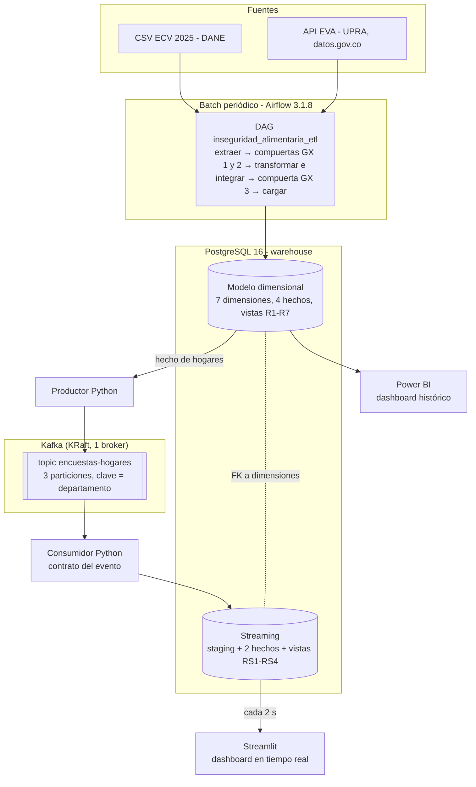

# Factores socioeconómicos asociados a la inseguridad alimentaria en los hogares colombianos

Entrega final del proyecto ETL: integración de la ECV 2025 del DANE y las Evaluaciones Agropecuarias Municipales (EVA) de la UPRA, con procesamiento batch orquestado en Airflow y un componente de streaming con Kafka.

> Documento en construcción.

## 1. Descripción del proyecto y objetivos

## 2. Fuentes de datos y EDA

## 3. Arquitectura del sistema



| Componente | Dónde corre | Función |
|---|---|---|
| Airflow, PostgreSQL (metadatos y warehouse), Kafka | Docker Compose | Orquestación, almacenamiento y transporte de eventos. Kafka está en el perfil `streaming`. |
| Productor, consumidor y dashboard en tiempo real | Entorno virtual de Python 3.12 | Se conectan por `127.0.0.1` a Kafka (9092) y al warehouse (5434). |
| Power BI | Equipo del usuario | Lee las vistas R1-R7 del warehouse. |

## 4. Pipeline ETL batch

## 5. Calidad de datos

## 6. Data Warehouse

## 7. Dashboard analítico batch

## 8. Pipeline de streaming

### 8.1 Qué se transmite y por qué con baja latencia

**Simulación declarada.** La ECV 2025 ya está cargada en el DW. El productor re-publica `fact_seguridad_alimentaria_hogar` hogar por hogar como si las encuestas llegaran del trabajo de campo. En un operativo real, esperar al cierre de la encuesta (meses) para conocer la prevalencia retrasa la focalización de la ayuda alimentaria. Ver la prevalencia acumulada y las alertas por departamento mientras llegan las encuestas permite reaccionar antes.

| Elemento | Decisión |
|---|---|
| Origen de los eventos | El hecho de hogares del DW con su geografía y severidad, leído una vez al arrancar ([`src/streaming/fuente.py`](src/streaming/fuente.py)). El hogar se identifica por su clave natural (`directorio`, `orden`): las claves sustitutas cambian en cada carga. |
| Orden y ritmo | Orden mezclado y reproducible (semilla 42). Ritmo configurable en eventos por segundo (`--eventos-por-segundo`, 50 por defecto). |
| Demo recortada | `streaming/precargar.py` deja un porcentaje de hogares como ya recibidos (el operativo ya está avanzado) y `productor.py --pendientes` publica solo los que faltan. Los precargados se marcan con `origen = 'precarga'` y no cuentan en las métricas de salud del flujo ni de latencia. |
| Topic | `encuestas-hogares`, 3 particiones, replicación 1, creado por el servicio `kafka-init` (la creación automática de topics está apagada). |
| Clave del mensaje | Código del departamento: los eventos de un departamento llegan en orden dentro de su partición. |
| Entrega del productor | Idempotente (`enable.idempotence`): sin pérdidas ni duplicados por reintentos internos. |

### 8.2 Contrato del evento

Definido en [`src/streaming/contrato.py`](src/streaming/contrato.py), que comparten productor y consumidor. Los rangos reutilizan las reglas del batch ([reglas de calidad](docs/reglas_calidad.md)).

| Campo | Tipo | Regla |
|---|---|---|
| `version_contrato` | entero | = 1 |
| `id_evento` | texto | UUID (identificador del evento) |
| `momento_evento` | texto | ISO-8601 con zona horaria (marca de tiempo de emisión) |
| `directorio`, `orden` | texto | solo dígitos; hasta 10 y 2 caracteres |
| `codigo_departamento` | texto | 2 dígitos (C2) e igual a la clave del mensaje |
| `codigo_region`, `codigo_clase` | texto | 1 carácter |
| `nombre_severidad` | texto | uno de los 5 niveles de `dim_nivel_severidad_ia` |
| `factor_expansion` | número | finito y mayor que 0 |
| `prob_ia_moderada_grave`, `prob_ia_grave` | número o null | 0-100; null si y solo si la severidad es «Sin dato» (C12); grave ≤ moderada o grave |

Validación en cuatro capas; cada mensaje queda en el staging con su estado y su motivo:

| Capa | Qué revisa | Estado si falla |
|---|---|---|
| Esquema | JSON legible, campos presentes, tipos | `INVALIDO_ESQUEMA` |
| Valores | Rangos y reglas de negocio | `INVALIDO_VALORES` |
| Referencia | Departamento, región, clase y severidad existen en las dimensiones | `INVALIDO_REFERENCIA` |
| Duplicado | El hogar o el `id_evento` no se recibieron antes | `DUPLICADO` |

`--con-invalidos` intercala seis eventos dañados a propósito que cubren las cuatro capas (falta un campo, texto en un número, JSON cortado, probabilidad 150, departamento `00` inexistente y un hogar repetido).

### 8.3 Consumidor

[`streaming/consumidor.py`](streaming/consumidor.py) (lógica en [`src/streaming/procesamiento.py`](src/streaming/procesamiento.py)). Procesa **micro-lotes** de hasta 200 mensajes:

1. Guarda cada mensaje tal como llegó en `stg_evento_encuesta`, antes de validarlo.
2. Valida cada mensaje con el contrato y resuelve sus claves en las dimensiones.
3. Inserta los válidos en `fact_evento_encuesta` y suma sus valores al snapshot `fact_metrica_departamento_stream`.
4. Marca el estado final de cada mensaje.
5. Confirma la transacción de la base y **después** los offsets en Kafka.

| Garantía | Cómo se logra |
|---|---|
| Un evento inválido no detiene el consumidor | Queda registrado con estado y motivo; el lote sigue. |
| Sin pérdidas al detener o matar el consumidor | Los offsets se confirman solo después del commit de la base; Kafka reentrega lo no confirmado. |
| Sin duplicados | `UNIQUE (topic, particion, desplazamiento)` en el staging (una reentrega ya guardada se omite) y `UNIQUE (directorio, orden)` en el hecho. |
| Falla de la base | Se revierte el lote completo y el consumidor se detiene con código 1. |
| Kafka caído | El consumidor lo detecta (aviso de la librería o sondeo de metadatos cada 10 s) y se detiene con código 1 en vez de quedar esperando. |
| Rendimiento | Escrituras en bloque: ~6 sentencias por lote. Medido en un Mac Intel de 8 GB con Docker: ~1.800 eventos/s, latencia media de 0,6 s a 100 eventos/s. |

### 8.4 Modelo y métricas

Las tablas del streaming son parte del modelo dimensional ([DDL](sql/create_tables.sql), [modelo](docs/modelo_dimensional.dbml)):

| Tabla | Grano | Claves |
|---|---|---|
| `stg_evento_encuesta` | Un mensaje de Kafka, guardado antes de validarlo (staging, fuera del modelo analítico) | PK `id_evento_crudo`; único por topic, partición y desplazamiento |
| `fact_evento_encuesta` | La llegada válida de la encuesta de un hogar | PK sustituta; FK a `dim_geografia` y `dim_nivel_severidad_ia`; únicos `id_evento` y (`directorio`, `orden`) |
| `fact_metrica_departamento_stream` | El estado acumulado del operativo en un departamento | PK y FK `id_departamento` → `dim_departamento` |

El snapshot guarda solo conteos y sumas aditivas; las prevalencias se calculan como cociente de sumas, igual que en las vistas R1-R7. Métricas ([vistas](sql/vistas_streaming.sql)):

| Id | Métrica | Definición |
|---|---|---|
| RS1 | Avance de la recolección | Hogares recibidos / hogares de la muestra, por departamento y nacional |
| RS2 | Prevalencia acumulada | Σ(factor × probabilidad) / Σ factor sobre hogares con FIES, por departamento y nacional |
| RS3 | Alerta temprana | El límite inferior del IC 95 % de la prevalencia acumulada supera la prevalencia nacional del DW, con al menos 30 hogares con FIES (estados `sin_muestra`, `normal`, `alerta`) |
| RS4 | Salud del flujo | Mensajes por estado, latencia media y p95, eventos del último minuto |

Coherencia con el batch: al recibir todos los hogares, la prevalencia acumulada del streaming coincide con la del DW (21,10 % nacional y la misma cifra por departamento que la vista R6).

## 9. Dashboard en tiempo real

[`streaming/dashboard.py`](streaming/dashboard.py), en Streamlit: `streamlit run streaming/dashboard.py` → <http://localhost:8501>.

| Aspecto | Decisión |
|---|---|
| Integración | Consumidor → tablas del streaming en el warehouse → vistas `vw_stream_*` → Streamlit. El dashboard solo lee vistas, con una conexión de solo lectura que se reconecta si la base se reinicia. |
| Frecuencia | Refresco del panel cada **2 segundos** (`st.fragment(run_every=2)`). |
| Indicadores | Hogares recibidos y avance (RS1), prevalencia acumulada frente a la referencia del DW (RS2), departamentos en alerta (RS3), mensajes inválidos y latencia (RS4). |
| Gráficos | Prevalencia acumulada en el tiempo con la línea de referencia nacional; mensajes por estado; prevalencia por departamento coloreada por estado de alerta; tabla de los 33 departamentos con avance y límite inferior del IC. |
| Rendimiento | La referencia nacional y los hogares esperados por departamento son vistas materializadas que se recalculan en cada carga del DAG; las vistas solo recorren los eventos llegados por Kafka. |

| | Dashboard histórico (Power BI) | Dashboard en tiempo real (Streamlit) |
|---|---|---|
| Pregunta | ¿Qué factores se asocian con la inseguridad alimentaria? (R1-R7) | ¿Cómo va el operativo y dónde hay que actuar ya? (RS1-RS4) |
| Datos | Resultado final del DW, por carga del DAG | Estado acumulado mientras llegan las encuestas |
| Actualización | Al refrescar el informe después de una carga | Cada 2 segundos |

## 10. Ejecución y reproducibilidad

Guía completa, con resultados esperados y solución de problemas: **[docs/guia_ejecucion.md](docs/guia_ejecucion.md)**. Resumen (PowerShell; en macOS/Linux cambian la activación del entorno y la copia de archivos):

```powershell
# Preparación
Copy-Item .env.example .env
#   descargar los CSV de la ECV en data/raw/ecv (data/raw/README.md)
py -3.12 -m venv .venv
.\.venv\Scripts\Activate.ps1
pip install -r requirements.txt
python -m pytest -q

# Batch
docker compose build
docker compose up airflow-init
docker compose up -d                      # Airflow: http://localhost:8081
#   activar y disparar el DAG inseguridad_alimentaria_etl

# Streaming (con el DW cargado)
docker compose --profile streaming up -d warehouse kafka kafka-init
python streaming/reiniciar_demo.py --si
python streaming/precargar.py --porcentaje 90
streamlit run streaming/dashboard.py                                          # terminal 1
python streaming/consumidor.py                                                # terminal 2
python streaming/productor.py --pendientes --eventos-por-segundo 100 --con-invalidos   # terminal 3
```

| Requisito | Versión |
|---|---|
| Docker Desktop | Compose v2, al menos 3 GB de RAM asignados |
| Python | 3.12 (entorno virtual) |
| Imágenes | Airflow 3.1.8 (imagen propia, [Dockerfile](Dockerfile)), PostgreSQL 16, Kafka 3.9.1 |
| Librerías | [requirements.txt](requirements.txt) (entorno virtual) y [requirements-airflow.txt](requirements-airflow.txt) (imagen de Airflow) |

No hay credenciales reales en el repositorio: [.env.example](.env.example) trae valores de desarrollo local y todos los puertos se publican solo en `127.0.0.1`.

## 11. Evidencia funcional

Cada experimento se describe, con su resultado esperado, en la [guía de ejecución](docs/guia_ejecucion.md) (marcas 📸).

| Evidencia | Sección de la guía |
|---|---|
| Corrida exitosa del DAG (12 tareas) y conteos de la carga | 2.2 y 2.3 |
| Resultados de Great Expectations (compuertas 1, 2 y 3) | 2.3 |
| Fallo crítico visible en Airflow y carga bloqueada (regla C7) | 2.4 |
| Reejecución segura | 2.5 |
| Productor y consumidor en operación; métricas que cambian en el dashboard | 3.3 |
| Eventos inválidos registrados con su motivo | 3.3 |
| Consumidor detenido y reanudado sin pérdidas ni duplicados | 3.4 |
| Kafka caído | 3.5 |
| Coherencia streaming = DW | 3.6 |

## 12. Decisiones de ingeniería y limitaciones
